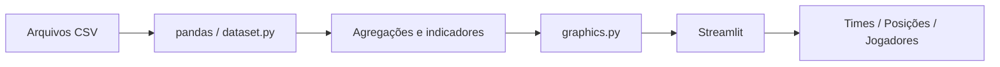
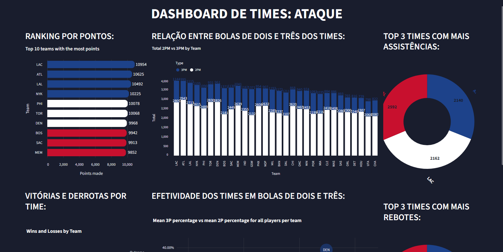
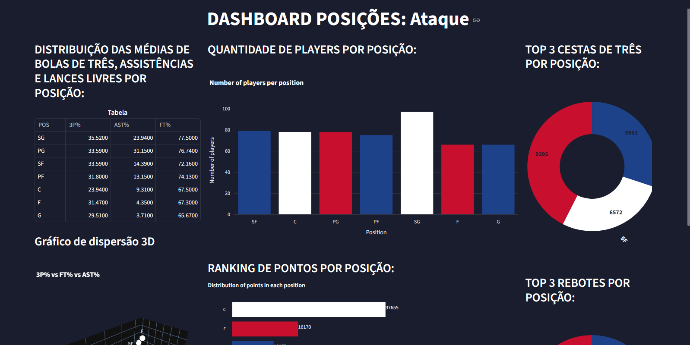
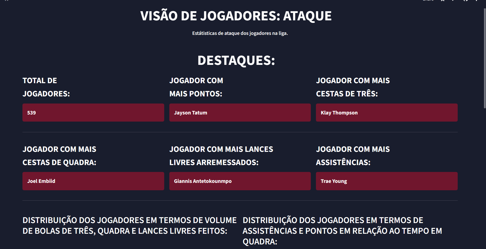
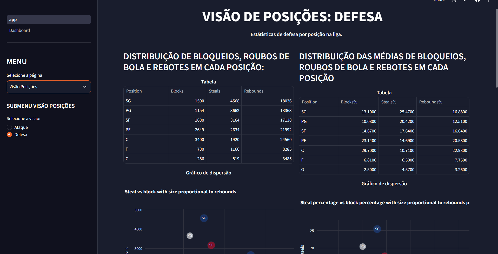

<div align="center">

# 🏀 NBA Analytics 2023
### Dashboard de análise exploratória da NBA com Python


[](https://nbaprojectapp2023.streamlit.app/)
[](https://github.com/kobzc/NBAproject2023)

**[GitHub do autor](https://github.com/kobzc) · [LinkedIn](https://www.linkedin.com/in/lucas-r-constantino/)**

</div>

---

## 📌 Sobre

O **NBA Analytics 2023** é um dashboard desenvolvido com **Python e Streamlit** para explorar estatísticas históricas da NBA. A aplicação transforma dados em CSV em visualizações interativas e organiza a análise em três perspectivas: **times, posições e jogadores**.

O foco é explorar indicadores ofensivos e defensivos, como pontos, aproveitamento de arremessos, assistências, rebotes, roubos de bola e bloqueios.

### 🌐 Experimente o dashboard

**[▶ Abrir aplicação online](https://nbaprojectapp2023.streamlit.app/)** · **[💻 Explorar código-fonte](https://github.com/kobzc/NBAproject2023)**

A demonstração está hospedada no **Streamlit Community Cloud**. Se a aplicação estiver em repouso, abra o link e clique em **“Get this app back up”** (ou na opção equivalente exibida pelo Streamlit) para solicitar sua reativação. Aguarde alguns instantes até o dashboard carregar.

Caso a hospedagem esteja temporariamente indisponível, o repositório continua disponível para consultar o código e executar o projeto localmente seguindo as instruções abaixo.

## ✨ Funcionalidades

| Módulo | Recursos |
| --- | --- |
| 🏟️ **Visão Times** | Rankings, comparações entre equipes, estatísticas de ataque e defesa e seleção de times |
| 📊 **Visão Posições** | Distribuições de pontuação, aproveitamento, assistências, rebotes e ações defensivas por posição |
| ⭐ **Visão Jogadores** | Líderes estatísticos, arremessos, triplos-duplos e gráficos relacionando desempenho a minutos e jogos |
| 🎛️ **Navegação** | Menu lateral para alternar entre as três visões e opções de ataque/defesa |

## 🛠️ Stack

- **Python e pandas:** leitura, tratamento, filtragem e agregação dos dados.
- **Streamlit:** interface interativa e navegação.
- **Plotly e Altair:** gráficos de barras, dispersão, caixa e visualizações tridimensionais.
- **Pillow e CSS:** imagens e personalização visual.

## 🗂️ Organização do código

```text
NBAproject2023/
├── app.py                    # Entrada do Streamlit e menu
├── pages/
│   ├── visao_times/          # Análises por equipe
│   ├── visao_posicoes/       # Análises por posição
│   └── visao_jogadores/      # Análises por jogador
├── data/
│   ├── dataset.py            # DataFrames e indicadores derivados
│   ├── data_merged.csv       # Base consolidada
│   ├── df_times.csv          # Estatísticas por equipe
│   └── 2023_nba_player_stats.csv
├── graphics.py               # Gráficos
├── utils.py                  # Leitura e filtros
├── styles.py                 # Funções de apresentação
├── styles.css                # Estilização
├── assets/                   # Recursos visuais
└── requirements.txt          # Dependências
```

## 🚀 Como executar

**Pré-requisito:** Python instalado.

```bash
git clone https://github.com/kobzc/NBAproject2023.git
cd NBAproject2023
python -m venv .venv
```

Ative o ambiente virtual:

**Windows (PowerShell):**
```powershell
.venv\Scripts\Activate.ps1
```

**Linux/macOS:**
```bash
source .venv/bin/activate
```

Instale as dependências e inicie:

```bash
pip install -r requirements.txt
streamlit run app.py
```

O Streamlit normalmente disponibiliza a interface em `http://localhost:8501`.

> **Compatibilidade:** as instruções descrevem a inicialização esperada a partir do código. A execução não foi testada nesta revisão; versões atuais de bibliotecas podem exigir ajustes.

## 📈 Fluxo de dados



Os dados são históricos e armazenados no repositório; **não há atualização de resultados em tempo real**.

## 💡 Competências demonstradas

- Análise exploratória e manipulação de dados com pandas.
- Criação de indicadores, rankings e agrupamentos estatísticos.
- Desenvolvimento de dashboards interativos.
- Separação entre preparação de dados, visualizações e interface.
- Comunicação visual de métricas de desempenho esportivo.

## 📸 Capturas de tela

As imagens abaixo mostram a aplicação em funcionamento, incluindo gráficos, indicadores e tabelas. Clique para ampliar.

### Dashboard de times — ataque

[](screenshots/dashboard-times.png)

### Dashboard de posições — ataque

[](screenshots/dashboard-positions.png)

### Visão de jogadores — ataque

[](screenshots/players-offense.png)

<details>
<summary><strong>Ver também: análise defensiva por posição</strong></summary>



</details>

> As capturas representam o conjunto de dados histórico utilizado pelo projeto, não resultados em tempo real.

## 🔧 Melhorias planejadas

- Criar um GIF curto demonstrando a navegação entre as páginas.
- Revisão e redução das dependências.
- Testes automatizados para transformações de dados.
- Documentação da fonte e licença dos datasets.
- Revisão de compatibilidade com versões atuais do Streamlit.

---

<div align="center">

Feito por **[Lucas Constantino (Kobz)](https://github.com/kobzc)**

[Portfólio GitHub](https://github.com/kobzc) · [LinkedIn](https://www.linkedin.com/in/lucas-r-constantino/)

</div>
